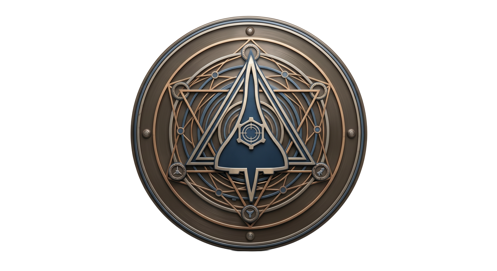

# Concordia

  

**C**ontrol  
**O**f  
**N**etwork  
**C**onnected  
**O**bject  
**R**obotics  
**D**evices &  
**I**ntelligence  
**A**gents  

## Project Purpose
Concordia is a centralised command centre for controlling all sorts of robotics (destructive/non-destructive) projects. Its base version is built solely for real-time combat robotics man-in-the-middle control, providing real-time data from the robot and the ability to communicate with it via multiple channels.

The project is developed in-house in C/C++ for low-latency, compiled performance, with FLTK used as the GUI framework for its low resource usage and cross-platform support.

